# Olá, eu sou o Gabriel Marchione! 👋

**Software Developer · Formado em Sistemas de Informação**

---

## 👨‍💻 Sobre mim

- 💼 Software Developer
- 🎓 Formado em Sistemas de Informação
- 💻 Desenvolvedor Full Stack, trabalhando com **C#**, **.NET** e **Windows Forms**
- 🗄️ Experiência com bancos de dados **SQL Server**

## 🛠️ Tecnologias e ferramentas

  
  &nbsp;
  
  &nbsp;
  
  &nbsp;
  
  &nbsp;
  

| Área | Tecnologias |
| --- | --- |
| Linguagens | C#, Python |
| Plataforma | .NET, Windows Forms |
| Banco de dados | SQL Server |
| Ferramentas | Visual Studio, VS Code |

## 📊 Estatísticas do GitHub

<!--
Os dois cards acima são gerados pelo workflow .github/workflows/update-stats.yml
e salvos na pasta profile/ deste repositório. Para atualizar na hora:
aba Actions > "Atualizar cards do README" > Run workflow.
-->

## 📫 Contato
Descomente e preencha com os seus links:

